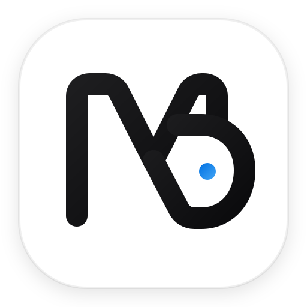

<div align="center">
  
  <h1>MD DIGITAL · WIEN</h1>
  <p><strong>High-End Web Architecture & 4K Cinema Photography für Wiener Betriebe</strong></p>
  <p>
    <a href="https://d10ud.github.io/md-digital-websites/"></a>
    <a href="https://wa.me/436765878022"></a>
    <a href="tel:+436765878022"></a>
  </p>
</div>

---

## 🏛️ Über MD DIGITAL

**MD DIGITAL** ist ein unabhängiges studentisches Studio aus Wien. Gegründet von **Daoud Sahel** (Software-Entwicklung & Web-Architektur) und **Marcel Pasik** (Medienproduktion & Fotografie). 

Wir verbinden kompromisslos schnellen, handgeschriebenen Web-Code mit echter 4K-Kameraoptik vor Ort &mdash; ohne teuren Agentur-Wasserkopf, zu transparenten und fairen Konditionen für Wiener Klein- und Meisterbetriebe.

### 👥 Das Gründer-Team
* **Daoud Sahel** &mdash; *Lead Web Architecture & Performance*: Entwickelt auf Apple Silicon M4 blitzschnelle Websites (< 0.4s Ladezeit, 100/100 Google Lighthouse) ohne anfällige Plugins oder WordPress-Bloatware.
* **Marcel Pasik** &mdash; *Director of Photography & Media*: Schießt mit Sony Cinema Mirrorless 4K und Tamron 70-200mm f/2.8 SP Di VC USD G2 Teleobjektiv gestochen scharfe, authentische Porträts und Ladenaufnahmen direkt vor Ort in Wien.

---

## 💶 Transparente Studenten-Festpreise

| Leistung | Beschreibung | Festpreis |
| :--- | :--- | :--- |
| **One-Pager Express Website** | Kompakter, moderner Webauftritt auf Apple-Designstandard, mobiloptimiert, SSL, 0.4s Ladezeit | **399 €** |
| **Multi-Page Business Website** | Ausführliche Unternehmenspräsenz mit Unterseiten, Menü/Katalog, Buchungsmodulen & FAQ | **599 €** |
| **4K Vor-Ort Foto-Shooting mit Marcel** | Sony ZV-E10 + Tamron 70-200mm f/2.8 Aufnahmen Ihres Teams & Geschäfts in Wien inkl. Photoshop RAW-Retusche | **+100 €** |
| **Google Maps & Local SEO Setup** | Optimierung für Google Search & Maps für Ihren Wiener Bezirk (1010, 1070 etc.) | **+99 €** |

*Keine monatlichen Knebelverträge. Sie besitzen 100% aller Rechte an Code und Fotos.*

---

## 📸 Kamera-Setup & Hardware Rig

```
Camera Body : Sony ZV-E10 (4K Mirrorless Cinema APS-C, High Dynamic Range)
Lens        : Tamron SP 70-200mm f/2.8 Di VC USD G2 (Cremiges Bokeh, Freistellung)
Development : Apple Silicon M4 Architecture (Metal GPU Accelerated)
Post-Prod   : Adobe Photoshop & Lightroom (RAW Color Science & Denoise)
```

---

## 📂 Repository-Struktur

```
.
├── index.html                  # Master-Website (Apple Light Aesthetic, Before/After Slider, Rechner)
├── demo-barber.html            # Interaktives Live-Showcase für Barbershops & Salons (1010 Wien)
├── demo-tech.html              # Interaktives Live-Showcase für Tech Stores & Reparaturen (1070 Wien)
├── impressum.html              # Rechtssicheres Impressum (§ 5 ECG, § 25 Mediengesetz) & DSGVO
├── favicon.svg                 # Vektor Browser-Icon
└── assets/
    ├── brand/
    │   ├── logo-mark.svg       # M&D Monogramm Vektor-Branding
    │   ├── md-logo.svg         # Alternatives Vektor-Icon
    │   ├── logo-horizontal.svg # Horizontales Wortmarken-Logo
    │   └── studio-logo-mockup.jpg # 3D Titan & Saphirglas Studio-Render
    └── images/                 # Verifizierte hochauflösende Fotografien
        ├── barber-fade.jpg     # 4K Friseur-Detailfoto
        ├── barber-tools.jpg    # Handwerks-Ausrüstung
        ├── camera-macro.jpg    # Tamron 70-200mm f/2.8 Blende & Optik
        ├── restaurant-gourmet.jpg # Wiener Gastronomie-Ambiente
        ├── sony-camera.jpg     # Sony ZV-E10 Gehäuse
        ├── tamron-lens.jpg     # Tele-Zoom Objektiv
        ├── tech-repair.jpg     # Smartphone-Werkbank & Mikroskop
        └── vienna-night.jpg    # Wien Architektur
```

---

## 🚀 Live Vorschau & Hosting

* **Online URL**: [https://d10ud.github.io/md-digital-websites/](https://d10ud.github.io/md-digital-websites/)
* **Lokal auf macOS öffnen**:
  ```bash
  open /Users/daoud/Desktop/MD-Digital-Websites/index.html
  ```

---

## 📞 Kontakt & Impressum

* **Telefon / WhatsApp**: [+43 676 5878022](https://wa.me/436765878022)
* **E-Mail**: [mddigital.at@gmail.com](mailto:mddigital.at@gmail.com)
* **Standort**: Wien, Österreich
* **Rechtliches**: Siehe [impressum.html](https://d10ud.github.io/md-digital-websites/impressum.html)

&copy; 2026 MD DIGITAL · Daoud Sahel & Marcel Pasik
